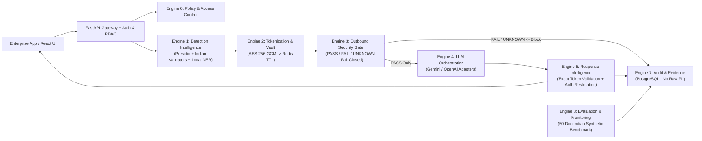
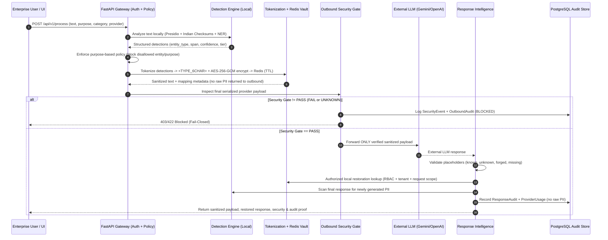

# System Architecture — Privacy Gateway AI

## 1. High-Level Modular Monolith Architecture

Privacy Gateway AI is structured as a modular monolith in FastAPI with eight cleanly separated engines behind explicit Python interfaces, backed by PostgreSQL (metadata, policies, audits, evaluation runs) and Redis (short-lived AES-256-GCM encrypted mappings).

## 2. End-to-End Request Data Flow (8-Stage Workflow)

## 3. Eight Logical Engines

1. **Detection Intelligence Engine (`app/services/detection/`):**
   - Microsoft Presidio Analyzer + custom Indian recognizers (`AADHAAR` with Verhoeff checksum, `PAN` with 4th-char entity code validation, `GSTIN` with Mod-36 checksum & embedded PAN check, `VOTER_ID`, `PASSPORT`, `IFSC`, `BANK_ACCOUNT`, `UPI_ID`, `PHONE_NUMBER`, `EMAIL_ADDRESS`, `DATE_OF_BIRTH`, `CREDIT_CARD`, `CUSTOMER_ID`).
   - Local NER (`spaCy` / `GLiNER` when configured, with deterministic local Indian name/honorific/address structural + contextual extractors so detection never calls external APIs and always works reliably offline).
   - Safe overlap resolution prioritizing higher specificity & confidence (e.g., GSTIN over embedded PAN; Aadhaar over generic digits).
2. **Tokenization & Privacy Vault Engine (`app/services/tokenization/`, `app/services/privacy_vault/`):**
   - Cryptographically random 6-character alphanumeric token suffix (`secrets.token_urlsafe`/base32), e.g., `<AADHAAR_7K2P9X>`.
   - Request-scoped deterministic reuse: identical normalized `(entity_type, canonical_value)` within a request gets the same placeholder.
   - Collision guard: checks input text so user-supplied text matching `<..._......>` cannot collide with or spoof vault tokens.
   - Encrypted at rest in Redis using AES-256-GCM (`cryptography.hazmat.primitives.ciphers.aead.AESGCM`) with AAD binding `(org_id, request_id, placeholder)` and separate `MAPPING_ENCRYPTION_KEY`.
   - Short configurable TTL (default 900s). Fails closed if Redis is unreachable.
3. **Outbound Security Enforcement Engine (`app/services/security_gate/`):**
   - Placed at the final transport boundary right inside the LLM client dispatch wrapper (not merely on intermediate strings).
   - Inspects the complete serialized provider JSON payload (system prompt, user prompt, history, tool definitions/arguments, metadata).
   - Verifies: zero known original PII substrings/normalized variants, zero encryption keys or vault payloads, only valid request-scoped placeholders, provider allowlist, active policy approval, and valid security context.
   - Returns `PASS`, `FAIL`, or `UNKNOWN`. Only `PASS` proceeds; `FAIL` and `UNKNOWN` block and emit `SecurityEvent`.
   - Transport guard ensures provider adapters cannot be invoked without a verified `SecurityGateTicket` issued for that exact payload SHA-256 hash.
4. **LLM Orchestration Engine (`app/services/llm/`):**
   - Provider-independent `BaseLLMProvider` interface with `GeminiAdapter` (Google Gemini REST/SDK) and `OpenAIAdapter`.
   - Enforces allowlist, timeouts, bounded retries (re-verifying ticket integrity on retry), latency & token tracking, and secret redaction in logs.
5. **Response Intelligence Engine (`app/services/restoration/`):**
   - Extracts all placeholder-like tokens from model output.
   - Classifies tokens into `valid_restored`, `missing_from_response`, `unknown_or_forged`.
   - Performs exact case-sensitive vault lookup bound to `(org_id, request_id)`—never fuzzy matching.
   - Checks user restoration authorization (`can_restore` RBAC + purpose policy) before unmasking; unauthorized users receive sanitized/redacted output with restoration denied status.
   - Scans final response for newly generated PII.
6. **Privacy Policy & Access Control Engine (`app/services/policies/`, `app/core/auth.py`):**
   - JWT auth + RBAC roles (`admin`, `security_officer`, `privacy_officer`, `developer`, `analyst`, `auditor`).
   - Purpose-based rules (e.g., `loan_underwriting`, `kyc_verification`, `customer_support`, `insurance_claims`, `marketing_analytics`) controlling allowed entities, blocked entities (e.g., block `AADHAAR` for `marketing_analytics`), allowed providers, and restoration permissions.
7. **Audit, Evidence & Compliance Engine (`app/services/audit/`):**
   - Persists request metadata, detected entity types & counts (never raw PII), outbound payload SHA-256 + sanitized preview, security gate decision, provider/model, response restoration status, and latency into PostgreSQL.
   - Supports search, request-level investigation, security event history, and JSON/CSV DPDP evidence export.
8. **Evaluation & Monitoring Engine (`app/services/evaluation/`):**
   - Runs reproducible benchmarks over the 50-document synthetic Indian enterprise dataset (`dataset/`).
   - Computes TP, FP, FN, Precision, Recall, F1 (overall & entity-wise, mandatory vs extended), outbound PII leakage count, placeholder reinsertion accuracy (including paraphrased/reordered/dropped tests), and p50/p95 local latency.

## 4. Data Retention & Privacy Policy Summary

| Data Category | Storage | Contains Raw PII? | Retention | Purpose |
|---|---|---|---|---|
| Tokenization Mappings | Redis (AES-256-GCM) | Yes (Encrypted) | 15 min TTL (auto-expire / explicit purge) | Authorized local response restoration |
| Request & Audit Metadata | PostgreSQL | **No** | Configurable (default 90 days) | DPDP accountability, security evidence |
| Sanitized Outbound Payload | PostgreSQL (optional/truncated preview + SHA-256) | **No** (verified by Gate) | 90 days | Prove zero raw PII transmitted |
| Evaluation Reports | PostgreSQL | **No** (synthetic dataset IDs only) | Persistent | Reproducible quality & leakage metrics |
